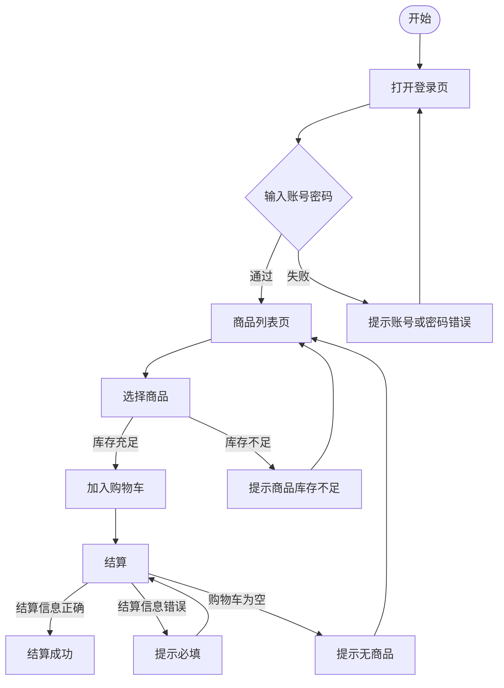

# Day 3 场景法、判定表、因果图、正交实验法实操

- **日期**：2026-10-21

## 练习 A（50 min）

用场景法为 saucedemo 的「登录 → 加入购物车 → 结算」画场景图，标出基本流，并至少列出 5 条备选流（如登录失败、库存不足、购物车为空、结算信息缺失、中途退出）。

### 登录 → 下单 场景

#### 基本流
1. 打开登录页
2. 输入 standard_user / secret_sauce
3. 点击 LOGIN
4. 进入商品列表页
5. 点击商品 → Add to cart
6. 点击购物车 → Checkout
7. 填写 First/Last/Zip → Continue
8. 点击 Finish → 订单完成

#### 备选流
| 编号 | 环节 | 异常 | 预期 |
| --- | --- | --- | --- |
| A1 | 登录 | 密码错误 | 提示不匹配，停留登录页 |
| A2 | 点击商品 | 库存不足 | 提示商品库存不足，返回商品列表 |
| A3 | 加入购物车 | 未登录直接访问 | 跳回登录页 |
| A4 | 结算 | First Name 留空 | 提示必填 |
| A5 | 结算 | 购物车为空时 Checkout | 提示无商品，返回商品列表 |

> 图只画了主流程和主要异常分支；A3（未登录直接访问）属于外部访问场景，未在图中体现。

## 练习 B（60 min）

用判定表设计「会员折扣」规则。条件：会员等级（普通 / 银卡 / 金卡）× 订单金额（小于 100 / 100–500 / 大于 500）× 是否促销期。先老老实实列全规则，再做合并，体会合并前后规则数的变化。普通会员：任何情况都无折扣 银卡：<100 无折扣；100–500 打 9 折；>500 打 85 折 金卡：<100 打 9 折；100–500 打 85 折；>500 打 8 折 促销期：银卡/金卡在以上基础上再打 95 折（普通不参与）
> **规则假设**：促销折扣为独立叠加层，计算方式为「最终实付 = 基础实付 × 95%」。
> 因此银卡 <100 且促销期时，原价 100% × 95% = 95%（即 95 折）。
> —— 此假设待产品确认。

### 表1（化简前）：普通会员

| 会员等级 | 金额 | 是否促销 | 实付 |
| --- | --- | --- | --- |
| 普通 | <100 | N | 100% |
| 普通 | <100 | Y | 100% |
| 普通 | 100-500 | N | 100% |
| 普通 | 100-500 | Y | 100% |
| 普通 | >500 | N | 100% |
| 普通 | >500 | Y | 100% |

### 表2（化简前）：银卡会员

| 会员等级 | 金额 | 是否促销 | 实付 |
| --- | --- | --- | --- |
| 银卡 | <100 | N | 100% |
| 银卡 | <100 | Y | 95% |
| 银卡 | 100-500 | N | 90% |
| 银卡 | 100-500 | Y | 85.5% |
| 银卡 | >500 | N | 85% |
| 银卡 | >500 | Y | 80.75% |

### 表3（化简前）：金卡会员

| 会员等级 | 金额 | 是否促销 | 实付 |
| --- | --- | --- | --- |
| 金卡 | <100 | N | 90% |
| 金卡 | <100 | Y | 85.5% |
| 金卡 | 100-500 | N | 85% |
| 金卡 | 100-500 | Y | 80.75% |
| 金卡 | >500 | N | 80% |
| 金卡 | >500 | Y | 76% |

### 表1（化简后）：普通会员

| 会员等级 | 金额 | 是否促销 | 实付 |
| --- | --- | --- | --- |
| 普通 | —— | —— | 100% |

### 表2（化简后）：银卡会员

| 会员等级 | 金额 | 是否促销 | 实付 |
| --- | --- | --- | --- |
| 银卡 | <100 | N | 100% |
| 银卡 | <100 | Y | 95% |
| 银卡 | 100-500 | N | 90% |
| 银卡 | 100-500 | Y | 85.5% |
| 银卡 | >500 | N | 85% |
| 银卡 | >500 | Y | 80.75% |

> 经检查，本表 6 条规则的动作项（实付比例）各不相同，无法合并，故化简前后一致。

### 表3（化简后）：金卡会员

| 会员等级 | 金额 | 是否促销 | 实付 |
| --- | --- | --- | --- |
| 金卡 | <100 | N | 90% |
| 金卡 | <100 | Y | 85.5% |
| 金卡 | 100-500 | N | 85% |
| 金卡 | 100-500 | Y | 80.75% |
| 金卡 | >500 | N | 80% |
| 金卡 | >500 | Y | 76% |

> 经检查，本表 6 条规则的动作项（实付比例）各不相同，无法合并，故化简前后一致。

### 化简效果总结

| 表 | 化简前 | 化简后 | 说明 |
| --- | --- | --- | --- |
| 表1 普通 | 6 | 1 | 金额和促销对普通会员均无关，全部合并 |
| 表2 银卡 | 6 | 6 | 每行实付各不相同，无法合并 |
| 表3 金卡 | 6 | 6 | 同上 |
| **合计** | **18** | **13** | 减少 28% |

## 练习 C（40 min）

用正交法设计兼容性用例。参数取 3 种浏览器 × 3 种操作系统 × 3 种分辨率 = 27 种组合，用正交表压到 9 条，写出这 9 条并说明「用 9 条覆盖主要组合」的价值。

| 用例 | 浏览器 | 操作系统 | 分辨率 |
| --- | --- | --- | --- |
| A1 | Chrome | Windows | 1920×1080 |
| A2 | Chrome | macOS | 1366×768 |
| A3 | Chrome | Linux | 2560×1440 |
| A4 | Firefox | Windows | 1366×768 |
| A5 | Firefox | macOS | 2560×1440 |
| A6 | Firefox | Linux | 1920×1080 |
| A7 | Safari | Windows | 2560×1440 |
| A8 | Safari | macOS | 1920×1080 |
| A9 | Safari | Linux | 1366×768 |

### 每个因素的每个水平都出现 3 次

- Chrome/Firefox/Safari 各 3 次
- Windows/macOS/Linux 各 3 次
- 三种分辨率各 3 次

### 任意两个因素的水平组合都至少覆盖一次

- 浏览器 × 操作系统：3×3=9 种组合全部出现
- 浏览器 × 分辨率：3×3=9 种组合全部出现
- 操作系统 × 分辨率：3×3=9 种组合全部出现

### 价值

- 用 1/3 的成本，系统覆盖所有两两因素组合，抓住大多数主要兼容性风险，同时保留对高风险三元组合补充测试的空间。
