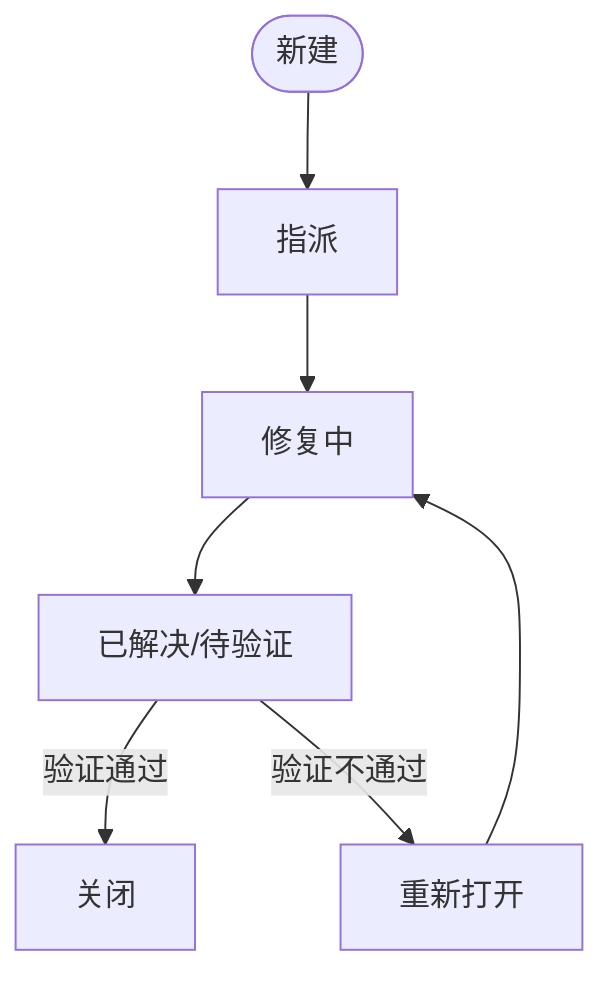

# Day 4 ｜ 缺陷管理理论

> 日期：2026-10-22

## 1. 理论要点

### 1.1 缺陷的定义与 5 个来源

- 定义：软件的实际行为与需求、设计或用户合理预期不一致。

| 来源 | 举例 |
| --- | --- |
| 需求不清 | 在以上基础上再打 95 折，在什么基础上没说清 |
| 设计缺陷 | 接口设计导致并发下超卖 |
| 编码错误 | > 写成 >= |
| 配置与环境差异 | 生产环境缺一个时区配置 |
| 数据问题 | 历史脏数据导致列表页报错 |

**关键认知**

- 缺陷 ≠ bug。"需求本身写错了"也是缺陷（需求缺陷），而且越早发现越省钱。（测试要尽早介入）

### 1.2 缺陷生命周期

- **旁支状态**

| 状态 | 什么情况 |
| --- | --- |
| 拒绝(Rejected) | 不是缺陷 / 无法复现 / 与需求一致 |
| 延期(Deferred) | 确认是缺陷，但本版本不修 |
| 重复(Duplicate) | 已有人提过同一个问题 |
| 无法复现 | 开发按步骤做不出同样结果（多半是环境或数据差异） |

- **每个状态谁在动**

| 状态 | 测试做什么 | 开发做什么 |
| --- | --- | --- |
| 新建 → 指派 | 提交缺陷单 | 接收并判断 |
| 修复中 | 准备回归用例 | 定位+修改 |
| 已解决 | 验证修复 | 提交代码 |
| 关闭 / 重新打开 | 下结论 | 重新打开后继续修 |

### 1.3 Severity 四级

| 等级 | 判定 | 举例 |
| --- | --- | --- |
| 致命/阻塞 | 系统崩溃、数据丢失、核心功能完全不可用、安全漏洞 | 支付成功但订单不生成 |
| 严重 | 主要功能不可用或有严重偏差，无替代方案 | 登录界面完全无法正常输入 |
| 一般 | 次要功能异常，有替代方案 | 排序结果偶尔错，手动找也能找到 |
| 轻微/建议 | 界面文字、排版、提示语 | 错别字、按钮没对齐 |

- **判定关键**

| 维度 | 功能 | 举例 |
| --- | --- | --- |
| 功能重要性 | 核心功能 vs 边缘功能 | 支付失败 vs 帮助页打不开 |
| 影响范围 | 全部用户 vs 特定条件 | 所有人登录失败 vs 只有 Safari 17 有问题 |
| 可否绕过 | 有替代路径 vs 完全阻塞 | 换浏览器能用 vs 完全没法用 |

- **同一现象，严重程度取决于影响边界**

| 情况 | Severity | 理由 |
| --- | --- | --- |
| 列表页价格错，**实付也错** | 致命 | 涉及资金 |
| 列表页价格错，**实付正确** | 严重 | 仅展示层，可绕过 |
| 列表页价格**对**，实付**错** | 致命 | 最危险，用户无感知 |

### 1.4 Priority 三级（修复顺序）

| 等级 | 含义 |
| --- | --- |
| P0 / 高 | 立即修复，阻塞发布 |
| P1 / 中 | 本迭代内必须修复 |
| P2 / 低 | 可延后到下个版本 |

- **Priority 由什么决定**

| 因素 | 说明 |
| --- | --- |
| 影响用户量 | 全量用户 vs 1% 用户 |
| 收入/合规影响 | 是否影响付费、是否有监管风险 |
| 修复成本 | 1 分钟改文案 vs 重构模块 |
| 发布节奏 | 是否卡住本次发版 |

### 1.5 Severity ≠ Priority

| 组合 | 例子 | 为什么 |
| --- | --- | --- |
| 高严重 + 低优先级 | 只有"某型号老旧设备 + 特定分辨率"下才崩溃 | 影响面极小，投入产出比低 |
| 低严重 + 高优先级 | 首页公司名称/LOGO 写错 | 所有用户都看到、影响品牌，改起来 1 分钟 |

- **记法**

> **Severity 是"伤得多重"，Priority 是"先救哪个"。**

- **Severity 是技术判断**：看功能重要性、影响范围、可否绕过
- **Priority 是业务决策**：看影响用户量、收入影响、修复成本、发布节奏

所以技术影响大不代表要马上修（可能没人碰到）；技术影响小也可能必须马上修（所有人都看到）。

### 1.6 缺陷报告 8 要素

1. 标题（能一眼看出问题）
2. 环境（操作系统 / 浏览器 / 版本号）
3. 前置条件（账号、数据、配置）
4. 复现步骤（编号，无跳跃）
5. 预期结果
6. 实际结果
7. 附件（截图 / 录屏 / 日志 / 请求响应）
8. 严重程度 + 优先级 + 指派给谁

- **合格标准**

开发照着做一遍，能得到和你一样的结果。

### 1.7 缺陷标题公式

【模块】+【操作】+【现象】+【条件】

| 反例 | 正例 |
| --- | --- |
| 结算有问题 | SauceDemo结算页面：输入正确的姓名和收货地址后点击结算无响应，页面停留在原状态 |
| 购物车显示错误 | SauceDemo购物车页面：点击商品页面「Add to cart」后进入购物车，页面依旧显示无商品 |

### 1.8 "可复现"的判定

| 缺什么 | 后果 |
| --- | --- |
| 环境 | 开发在自己电脑上复现不了 |
| 数据 | 用的是哪条数据？ID 是多少？ |
| 前置条件 | 有没有先登录？有没有先加购？ |
| 步骤跳跃 | "然后点一下" —— 点哪个？ |

### 1.9 工具

- 禅道 / Jira + Zephyr/Xray / TAPD / PingCode / MeterSphere

## 2. 复盘

- 最大的收获：
- 还没搞懂的：
