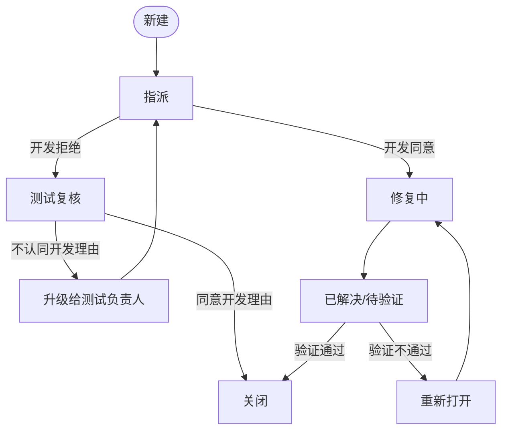

# Day 4 缺陷管理自检

- **日期**：2026-10-22

## 缺陷有哪 5 个来源？

1. 需求不清
2. 设计缺陷
3. 编码错误
4. 配置与环境差异
5. 数据问题

## 缺陷生命周期的完整流转？"拒绝"和"延期"分别在什么情况用？

- **重复**：已有人提过同一个问题，关联到原单
- **拒绝**：不是缺陷 / 无法复现 / 与需求一致
- **延期**：确认是缺陷，但本版本不修

## Severity 四级各举一个电商场景的例子？

| 等级 | 举例 |
| --- | --- |
| 致命/阻塞 | 未支付成功却依旧扣款 |
| 严重 | 电商平台在Windows系统上无法正常登录 |
| 一般 | 排序功能失效，商品始终按默认顺序显示（可手动翻页找到） |
| 轻微/建议 | 商品名有错别字 |

## Priority 由哪几个因素决定？

| 因素 | 说明 |
| --- | --- |
| 影响用户量 | 全量用户 vs 1% 用户 |
| 收入/合规影响 | 是否影响付费、是否有监管风险 |
| 修复成本 | 1 分钟改文案 vs 重构模块 |
| 发布节奏 | 是否卡住本次发版 |

## 举一个「高严重 + 低优先级」和「低严重 + 高优先级」的例子

- 高严重 + 低优先级

    用户在搜索页面输入一个特定罕见字会导致搜索页面闪退

- 低严重 + 高优先级

    首页底部的客服电话写错一位数字

## 缺陷报告的 8 要素？

1. 标题（能一眼看出问题）
2. 环境（操作系统 / 浏览器 / 版本号）
3. 前置条件（账号、数据、配置）
4. 复现步骤（编号，无跳跃）
5. 预期结果
6. 实际结果
7. 附件（截图 / 录屏 / 日志 / 请求响应）
8. 严重程度 + 优先级 + 指派给谁

## 把"搜索结果不准"改写成规范标题。

- 搜索页面：输入“手机”点击搜索，搜索结果中包含耳机、充电宝等非手机类商品

## 一份"开发会打回"的缺陷报告，通常缺什么？

1. 环境
2. 数据
3. 前置条件
4. 复现步骤
