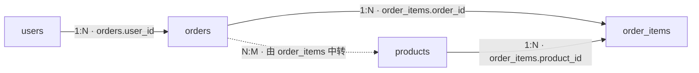

# Day 12 ｜ SQL 进阶：多表关联与测试专用查询

## 一、关系模型

### 1.1 四张表的连接关系（画一遍 1:N / N:M）

| 关系 | 类型 | 靠什么连 |
| --- | --- | --- |
| 用户 → 订单 | 一对多 | orders.user_id = users.id |
| 订单 → 明细 | 一对多 | order_items.order_id = orders.id |
| 商品 → 明细 | 一对多 | order_items.product_id = products.id |
| 订单 ↔ 商品 | 多对多（靠 order_items 当中间表） | 要经过 order_items 两次连接 |



### 1.2 为什么 JOIN 之后行数会变多（10 → 15）

- 10 张订单 × 每单平均 1.5 条明细  →  JOIN 后 15 行
                （订单 8 没有明细，被 INNER JOIN 剔除）

### 1.3 我的数据规模：5 / 6 / 10 / 16

**输入：**

```
SELECT 'users' AS 表名, COUNT(*) FROM users
UNION ALL SELECT 'products',     COUNT(*) FROM products
UNION ALL SELECT 'orders',       COUNT(*) FROM orders
UNION ALL SELECT 'order_items',  COUNT(*) FROM order_items;
```

**输出：**

```
+-------------+----------+
| 表名        | COUNT(*) |
+-------------+----------+
| users       |        5 |
| products    |        6 |
| orders      |       10 |
| order_items |       16 |
+-------------+----------+
```

## 二、四种 JOIN

### 2.1 一张表记住全部（含我这套数据的预期行数）

| 写法 | 保留哪些行 | 你的数据跑出来 |
| --- | --- | --- |
| INNER JOIN（= JOIN） | 两边都匹配的 | orders JOIN order_items → 15 行（订单 8 被剔除） |
| LEFT JOIN（左表驱动） | 左表全保留，右表没匹配补 NULL | orders LEFT JOIN order_items → 16 行（订单 8 补一行 NULL） |
| RIGHT JOIN | 右表全保留，反着来 | order_items RIGHT JOIN orders → 同上 16 行 |
| CROSS JOIN | 笛卡尔积，每行乘每行 | 10 × 16 = 160 行 |

1. 默认 JOIN 就是 INNER JOIN —— 只留两边都有的
2. 想找"主表有、从表没有"的，只能用 LEFT JOIN —— 因为 INNER 会把它删掉
3. RIGHT JOIN 永远可以改写成 LEFT JOIN（把两张表位置调换）—— 团队里一般只用 LEFT，读起来方向一致

### 2.2 INNER 会静默丢掉订单 8（实测）

**输入：**

```
SELECT o.id AS 订单号, o.total_amount AS 订单金额, i.product_id  AS 商品编号, i.quantity AS 数量
FROM orders o
JOIN order_items i ON i.order_id = o.id
ORDER BY o.id;
```

**输出：**

```
+--------+----------+----------+------+
| 订单号 | 订单金额 | 商品编号 | 数量 |
+--------+----------+----------+------+
|      1 |   398.00 |        1 |    1 |
|      1 |   398.00 |        2 |    1 |
|      1 |   398.00 |        4 |    1 |
|      2 |    99.00 |        2 |    1 |
|      2 |    99.00 |        5 |    1 |
|      3 |  1299.00 |        3 |    1 |
|      4 |   299.00 |        1 |    1 |
|      5 |   108.90 |        4 |    1 |
|      5 |   108.90 |        5 |    1 |
|      6 |    50.00 |        6 |    1 |
|      7 |   999.00 |        4 |    1 |
|      7 |   999.00 |        5 |    1 |
|      9 |   199.00 |        2 |    1 |
|      9 |   199.00 |        1 |    1 |
|     10 |    19.90 |        4 |    1 |
+--------+----------+----------+------+
15 rows in set (0.00 sec)
```

- INNER JOIN 同时丢掉两个方向：订单 8（缺明细）和孤儿明细 order_id=999（缺订单）。所以 10 张订单 × 16 条明细里，两边都对得上的那 15 条
- 后果：对账（JOIN + GROUP BY + HAVING）永远发现不了“缺”和“孤”这两类 —— 因为它们根本没进结果集。这就是五类必须分开查的根本原因。

### 2.3 LEFT 补 NULL 的实测输出

**输入：**

```
SELECT o.id AS 订单号, i.id AS 明细号, i.quantity AS 数量
FROM orders o
LEFT JOIN order_items i ON i.order_id = o.id
ORDER BY o.id;
```

**输出：**

```
+--------+--------+------+
| 订单号 | 明细号 | 数量 |
+--------+--------+------+
|      1 |      1 |    1 |
|      1 |      2 |    1 |
|      1 |     14 |    1 |
|      2 |      3 |    1 |
|      2 |     15 |    1 |
|      3 |      4 |    1 |
|      4 |      5 |    1 |
|      5 |      6 |    1 |
|      5 |      7 |    1 |
|      6 |      8 |    1 |
|      7 |      9 |    1 |
|      7 |     10 |    1 |
|      8 |   NULL | NULL |
|      9 |     11 |    1 |
|      9 |     12 |    1 |
|     10 |     13 |    1 |
+--------+--------+------+
16 rows in set (0.00 sec)
```

### 2.4 RIGHT 改写为 LEFT

**RIGHT形式：**

```
SELECT o.id, i.id FROM order_items i RIGHT JOIN orders o ON i.order_id = o.id;
```

**改成LEFT形式：**

```
SELECT o.id, i.id FROM orders o LEFT JOIN order_items i ON i.order_id = o.id;
```

- 这两种写法结果完全相同

### 2.5 MySQL 没有 FULL OUTER JOIN

- 想"两边都全保留"就用 UNION 拼 —— 关键是两段必须一个"左表驱动"、一个"右表驱动"：

```
-- ① 左表（orders）驱动：15 条匹配 + 订单 8 一行 NULL = 16 行
SELECT o.id AS 订单号, i.id AS 明细号
FROM orders o LEFT JOIN order_items i ON i.order_id = o.id

UNION

-- ② 右表（order_items）驱动：15 条匹配 + 孤儿明细一行 NULL = 16 行
SELECT o.id, i.id
FROM order_items i LEFT JOIN orders o ON o.id = i.order_id;

-- 去重后 17 行 = 15 条匹配 + 订单 8 + 孤儿明细（order_id = 999）
```

```
-- ❌ 这两句其实是同一个查询因为 2.4 那条：A LEFT JOIN B ≡ B RIGHT JOIN A，第二句的右表是 orders —— 还是 orders 驱动
SELECT ... FROM orders o      LEFT  JOIN order_items i ON i.order_id = o.id;
SELECT ... FROM order_items i RIGHT JOIN orders o      ON i.order_id = o.id;
```

- 看 FROM 后第一张表是谁，两段驱动表相同 = 白写一段
- 实战不这么做：拆成三条各自提单（15 / 1 / 1），因为“缺”和“孤”的责任方和严重级别不同。

### 2.6 CROSS JOIN 的危险（160 行）

- 忘写 ON 的 JOIN 就是 CROSS JOIN：

```
SELECT * FROM orders o JOIN order_items i;    -- 160 行，毫无意义
```

- 如果是 100 万行 × 100 万行，服务器直接挂。大表上误写笛卡尔积是真实事故，不是理论风险。

## 三、ON vs WHERE（今天最重要）

### 3.1 一句话区别

| 子句 | 时机 | 作用对象 |
| --- | --- | --- |
| ON | 连接时 | 只决定"哪些行能配上" |
| WHERE | 连接后 | 过滤最终结果 |

- 在 INNER JOIN 里两者结果一样（所以很多人以为没区别）； 在 LEFT JOIN 里差别巨大 —— 这正是最坑的地方。

### 3.2 实验 A（ON）与 B（WHERE）的行数对比

**实验A输入**

```
SELECT o.id AS 订单号, o.status, i.id AS 明细号, i.quantity
FROM orders o
LEFT JOIN order_items i
       ON i.order_id = o.id
      AND i.quantity = 1          -- ← 连接条件的一部分
ORDER BY o.id;
```

**实验A输出**

```
+--------+--------+--------+----------+
| 订单号 | status | 明细号 | quantity |
+--------+--------+--------+----------+
|      1 |      1 |      1 |        1 |
|      1 |      1 |      2 |        1 |
|      1 |      1 |     14 |        1 |
|      2 |      1 |      3 |        1 |
|      2 |      1 |     15 |        1 |
|      3 |      0 |      4 |        1 |
|      4 |      2 |      5 |        1 |
|      5 |      1 |      6 |        1 |
|      5 |      1 |      7 |        1 |
|      6 |      0 |      8 |        1 |
|      7 |      1 |      9 |        1 |
|      7 |      1 |     10 |        1 |
|      8 |      0 |   NULL |     NULL |
|      9 |      1 |     11 |        1 |
|      9 |      1 |     12 |        1 |
|     10 |      1 |     13 |        1 |
+--------+--------+--------+----------+
16 rows in set (0.00 sec)
```

**实验B输入**

```
SELECT o.id AS 订单号, o.status, i.id AS 明细号, i.quantity
FROM orders o
LEFT JOIN order_items i
       ON i.order_id = o.id
WHERE i.quantity = 1              -- ← 连接之后的过滤
ORDER BY o.id;
```

**实验B输出**

```
+--------+--------+--------+----------+
| 订单号 | status | 明细号 | quantity |
+--------+--------+--------+----------+
|      1 |      1 |      1 |        1 |
|      1 |      1 |      2 |        1 |
|      1 |      1 |     14 |        1 |
|      2 |      1 |      3 |        1 |
|      2 |      1 |     15 |        1 |
|      3 |      0 |      4 |        1 |
|      4 |      2 |      5 |        1 |
|      5 |      1 |      6 |        1 |
|      5 |      1 |      7 |        1 |
|      6 |      0 |      8 |        1 |
|      7 |      1 |      9 |        1 |
|      7 |      1 |     10 |        1 |
|      9 |      1 |     11 |        1 |
|      9 |      1 |     12 |        1 |
|     10 |      1 |     13 |        1 |
+--------+--------+--------+----------+
15 rows in set (0.00 sec)
```

| 观察项 | A（ON 里） | B（WHERE 里） |
| --- | --- | --- |
| 订单 8 还在吗 | 在（明细号是 NULL） | 不在了 |
| 总行数 | 更多 | 更少 |
| 本质 | 还是 LEFT JOIN | 已经退化成 INNER JOIN 了 |

### 3.3 为什么 B 退化成 INNER（三值逻辑）

- WHERE i.quantity = 1 遇到 i.quantity IS NULL 时结果是 UNKNOWN（还记得 Day 11 的三值逻辑吗？），UNKNOWN 的行被 WHERE 丢掉 —— 于是"左表全保留"这个特性被破坏了。

### 3.4 口诀

- LEFT JOIN 里，过滤右表的条件写 ON，过滤左表的条件写 WHERE。 写在 WHERE 里，那个 LEFT JOIN 就白写了。

## 四、三表与四表

### 4.1 我的三表查询

- 顺序：先定主表，再逐层挂

```
① 定主表：我要"以订单为单位"看 → FROM orders o
② 挂明细：JOIN order_items i ON i.order_id = o.id
③ 挂商品：JOIN products p    ON p.id = i.product_id
④ 挂用户：JOIN users u       ON u.id = o.user_id
```

- 每张订单买了哪些商品

**输入**

```
SELECT o.id AS 订单号, p.name AS 商品, i.quantity AS 数量, i.unit_price AS 单价
FROM orders o
JOIN order_items i ON i.order_id = o.id
JOIN products p    ON p.id = i.product_id
ORDER BY o.id, p.id;
```

**输出**

```
+--------+------------+------+---------+
| 订单号 | 商品       | 数量 | 单价    |
+--------+------------+------+---------+
|      1 | 机械键盘   |    1 |  299.00 |
|      1 | 无线鼠标   |    1 |   99.00 |
|      1 | USB 数据线 |    1 |   19.90 |
|      2 | 无线鼠标   |    1 |   99.00 |
|      2 | 笔记本支架 |    1 |   89.00 |
|      3 | 显示器     |    1 | 1299.00 |
|      4 | 机械键盘   |    1 |  299.00 |
|      5 | USB 数据线 |    1 |   19.90 |
|      5 | 笔记本支架 |    1 |   89.00 |
|      6 | 坏数据商品 |    1 |   50.00 |
|      7 | USB 数据线 |    1 |   19.90 |
|      7 | 笔记本支架 |    1 |   70.00 |
|      9 | 机械键盘   |    1 |  100.00 |
|      9 | 无线鼠标   |    1 |   99.00 |
|     10 | USB 数据线 |    1 |   19.90 |
+--------+------------+------+---------+
15 rows in set (0.00 sec)
```

### 4.2 我的四表查询

- 每个用户买了哪些商品

**输入**

```
SELECT u.id            AS 用户ID,
       u.username      AS 用户,
       o.id            AS 订单号,
       p.name          AS 商品,
       i.quantity      AS 数量
FROM users u
JOIN orders o      ON o.user_id = u.id
JOIN order_items i ON i.order_id = o.id
JOIN products p    ON p.id = i.product_id
ORDER BY u.id, o.id, p.id;        -- ← 关键：按 id 排，不按名字排
```

**输出**

```
+--------+--------+--------+------------+------+
| 用户ID | 用户   | 订单号 | 商品       | 数量 |
+--------+--------+--------+------------+------+
|      1 | 张三丰 |      1 | 机械键盘   |    1 |
|      1 | 张三丰 |      1 | 无线鼠标   |    1 |
|      1 | 张三丰 |      1 | USB 数据线 |    1 |
|      1 | 张三丰 |      2 | 无线鼠标   |    1 |
|      1 | 张三丰 |      2 | 笔记本支架 |    1 |
|      1 | 张三丰 |      7 | USB 数据线 |    1 |
|      1 | 张三丰 |      7 | 笔记本支架 |    1 |
|      1 | 张三丰 |      9 | 机械键盘   |    1 |
|      1 | 张三丰 |      9 | 无线鼠标   |    1 |
|      2 | 李四   |      3 | 显示器     |    1 |
|      2 | 李四   |      5 | USB 数据线 |    1 |
|      2 | 李四   |      5 | 笔记本支架 |    1 |
|      2 | 李四   |     10 | USB 数据线 |    1 |
|      3 | 王五   |      4 | 机械键盘   |    1 |
|      4 | 张三丰 |      6 | 坏数据商品 |    1 |
+--------+--------+--------+------------+------+
15 rows in set (0.00 sec)
```

### 4.3 行数怎么变化（判断挂的是多还是一）

**行数由"最细的那张表"决定：**

- 以 orders 为主表 → JOIN 明细后行数 = 明细条数（15），不是订单数（10）
- 再加 products（一对一挂上去）→ 行数不变，还是 15（每条明细只对应一个商品）
- 再加 users（一对多反着挂）→ 行数不变，还是 15

**口诀**

- 挂的是"多的一方"→ 行数变多；挂的是"一的一方"→ 行数不变。 这条能让你一眼看出"我这条 SQL 会不会把结果放大"

## 五、自连接与子查询

### 5.1 自连接找重名（为什么必须 u1.id < u2.id）

- 场景：同一张表内部要互相比。比如找"同名不同手机号"的用户。

**输入**

```
SELECT u1.id AS 用户A, u1.username, u1.phone,
       u2.id AS 用户B, u2.phone
FROM users u1
JOIN users u2
  ON u1.username = u2.username
 AND u1.id < u2.id          -- ← 关键：避免自己配自己 + 每对出现两次
ORDER BY u1.username;
```

**输出**

```
+-------+----------+-------------+-------+-------------+
| 用户A | username | phone       | 用户B | phone       |
+-------+----------+-------------+-------+-------------+
|     1 | 张三丰   | 13800000001 |     4 | 13800000004 |
+-------+----------+-------------+-------+-------------+
1 row in set (0.00 sec)
```

- 为什么必须 u1.id < u2.id：

1. 不加 → A配B 和 B配A 各出现一次（结果翻倍），还会出现 A配A
2. 加 < → 每对只出现一次，且排除自己

| 条件 | 行数 | 结果长什么样 |
| --- | --- | --- |
| 不写 ON（等于 CROSS JOIN） | 25 | 5 × 5 全组合，全是垃圾 |
| ON u1.username = u2.username | 7 | 3 个"自己配自己" + 张三丰的 4 种组合 |
| ... AND u1.id <= u2.id | 6 | 说明改成“只去掉 (4,1) 一个反向对，(1,4) 还留着” |
| ... AND u1.id <> u2.id | 2  | 张三丰 (A,B) 和 (B,A) —— 每对出现两次 |
| ... AND u1.id < u2.id | 1 ✅ | 只有 (A,B)，不重不漏 |

**其他自连接场景：**

| 场景 | 关键条件 | 想找的东西 |
| --- | --- | --- |
| 同一张表找"同名/同组" | u1.username = u2.username AND u1.id < u2.id | 重名用户 |
| 员工表找上级 | e.manager_id = m.id（manager_id 指回自己的 id） | 谁向谁汇报 |
| 员工表找老板 | LEFT JOIN ... WHERE m.id IS NULL | 没有上级的那个人 |
| 分类表找父类名 | c.parent_id = p.id | 二级分类属于哪个一级分类 |

### 5.2 标量 / IN / EXISTS 三种子查询

1. 标量子查询：返回一个值，可以放在比较里

**输入**

```
SELECT id, total_amount FROM orders
WHERE total_amount > (SELECT AVG(total_amount) FROM orders);
```

**输出**

```
+----+--------------+
| id | total_amount |
+----+--------------+
|  1 |       398.00 |
|  3 |      1299.00 |
|  7 |       999.00 |
+----+--------------+
```

2. IN 子查询：返回一列

**输入**

```
SELECT * FROM users
WHERE id IN (SELECT user_id FROM orders);
```

**输出**

```
+----+----------+-------------+--------+---------------------+
| id | username | phone       | status | created_at          |
+----+----------+-------------+--------+---------------------+
|  1 | 张三丰   | 13800000001 |      1 | 2026-10-29 15:37:45 |
|  2 | 李四     | 13800000002 |      1 | 2026-10-29 15:37:45 |
|  3 | 王五     | 13800000003 |      0 | 2026-10-29 15:37:45 |
|  4 | 张三丰   | 13800000004 |      1 | 2026-10-29 15:37:45 |
|  5 | 赵六     | 13800000005 |      1 | 2026-10-29 15:37:45 |
+----+----------+-------------+--------+---------------------+
```

3. EXISTS 子查询：只判断"存不存在"，不关心返回什么

**输入**

```
SELECT * FROM users u
WHERE EXISTS (SELECT 1 FROM orders o WHERE o.user_id = u.id);
```

**输出**

```
+----+----------+-------------+--------+---------------------+
| id | username | phone       | status | created_at          |
+----+----------+-------------+--------+---------------------+
|  1 | 张三丰   | 13800000001 |      1 | 2026-10-29 15:37:45 |
|  2 | 李四     | 13800000002 |      1 | 2026-10-29 15:37:45 |
|  3 | 王五     | 13800000003 |      0 | 2026-10-29 15:37:45 |
|  4 | 张三丰   | 13800000004 |      1 | 2026-10-29 15:37:45 |
|  5 | 赵六     | 13800000005 |      1 | 2026-10-29 15:37:45 |
+----+----------+-------------+--------+---------------------+
```

| 形态 | 返回什么 | 能单独跑吗 | 用外层别名吗 |
| --- | --- | --- | --- |
| 标量 | 1 行 1 列 | ✅ | ❌ |
| IN | 一列多行 | ✅ | ❌ |
| EXISTS | 真/假 | ❌ 报 1054 | ✅ 必须 |

- 独立子查询：括号里不依赖外层，能单独跑（标量、IN）
- 相关子查询（correlated）：引用了外层的 u.id，外层每取一行就重跑一次（EXISTS）
- IN 和 EXISTS 在我数据上结果完全一样，都是 5 行 —— 因为它们表达的是同一个命题（这个用户有没有订单）。差异只出现在两处：子查询含 NULL（NOT IN 会全空）和执行计划（看 EXPLAIN）。

**JOIN 和子查询怎么选**

| 需求 | 推荐 |
| --- | --- |
| 要右表的某些列 | JOIN |
| 只判断有没有 | EXISTS / NOT EXISTS |
| 要找不存在的 | LEFT JOIN ... WHERE 右表主键 IS NULL 或 NOT EXISTS |
| 一眼能看懂哪个 | 可读性优先 —— 两种都对时选短的那个 |

### 5.3 NOT IN 的 NULL 陷阱 + NOT EXISTS 改写

**危险写法**

```
SELECT * FROM users
WHERE id NOT IN (SELECT user_id FROM orders);
```

- 如果子查询里出现任何一个 NULL，整个结果变成空集。
- x NOT IN (1, 2, NULL) 等价于 x <> 1 AND x <> 2 AND x <> NULL —— 最后一项是 UNKNOWN，整个 AND 就废了。

**输出**

```
Empty set
```

- 这里 0 行不是 NULL 陷阱生效，而是「没人没下单」—— 5 个用户全都有订单
- 本例不炸是运气（orders.user_id 是 NOT NULL）；换成可空列会全空，所以一律用 NOT EXISTS

**安全写法**

```
SELECT * FROM users u
WHERE NOT EXISTS (SELECT 1 FROM orders o WHERE o.user_id = u.id);
```

### 5.4 UNION 与 UNION ALL

- UNION：去重（要排序，慢）

```
SELECT user_id FROM orders WHERE status = 1
UNION
SELECT user_id FROM orders WHERE status = 0;
```

- UNION ALL：不去重（快）

```
SELECT user_id FROM orders WHERE status = 1
UNION ALL
SELECT user_id FROM orders WHERE status = 0;
```

|  | 去重 | 排序 | 速度 | 用途 |
| --- | --- | --- | --- | --- |
| UNION | ✅ | 会排 | 慢 | 想要不同值 |
| UNION ALL | ❌ | 不排 | 快 | 默认用它，除非确定要去重 |

## 六、五类脏数据查询

### 6.1 缺：无明细订单（SQL + 命中）

**SQL**

```
SELECT o.id, o.total_amount, o.status
FROM orders o
LEFT JOIN order_items i ON i.order_id = o.id
WHERE i.id IS NULL;
```

**命中**

```
+----+--------------+--------+
| id | total_amount | status |
+----+--------------+--------+
|  8 |         0.00 |      0 |
+----+--------------+--------+
```

### 6.2 多：重名 / 重复明细

**重名用户 SQL**

```
SELECT username, COUNT(*) AS 条数, GROUP_CONCAT(phone) AS 手机号
FROM users
GROUP BY username
HAVING COUNT(*) > 1;
```

**重名用户 命中**

```
+----------+------+-------------------------+
| username | 条数 | 手机号                  |
+----------+------+-------------------------+
| 张三丰   |    2 | 13800000001,13800000004 |
+----------+------+-------------------------+
```

**重复明细 SQL**

```
SELECT order_id, product_id, COUNT(*) AS 条数
FROM order_items
GROUP BY order_id, product_id
HAVING COUNT(*) > 1;
```

**重复明细 命中**

```
Empty set (0.00 sec)
```

**为什么没有"重复手机号"这一类**

1. users.phone 建表时加了 UNIQUE → 重复手机号插不进去（Day 11 试过，报 ERROR 1062 Duplicate entry）
2. 所以“查重复手机号”这条 SQL 永远返回 0 行 —— 不是数据干净，是约束在拦
3. 能靠 GROUP BY + HAVING 查出问题的，只有没有约束保护的字段：username（重名）、order_items 的（订单+商品）组合
4. 有 UNIQUE / 主键的字段，GROUP BY 查不出问题，只能靠尝试插入重复值去测（看有没有 1062）
5. 报告里要分开写：“约束保证了它不会脏” ≠ “数据恰好干净”

### 6.3 错：金额对不上（含差异方向）

**SQL**

```
SELECT o.id,
       o.total_amount                AS 账面,
       SUM(i.quantity * i.unit_price) AS 明细合计,
       o.total_amount - SUM(i.quantity * i.unit_price) AS 差异
FROM orders o
JOIN order_items i ON i.order_id = o.id
GROUP BY o.id, o.total_amount
HAVING o.total_amount <> SUM(i.quantity * i.unit_price);
```

**命中**

```
+----+--------+----------+--------+
| id | 账面   | 明细合计 | 差异   |
+----+--------+----------+--------+
|  1 | 398.00 |   417.90 | -19.90 |
|  2 |  99.00 |   188.00 | -89.00 |
|  7 | 999.00 |    89.90 | 909.10 |
+----+--------+----------+--------+
```

### 6.4 孤：孤儿明细

**明细指向不存在的订单 SQL**

```
SELECT i.* FROM order_items i
LEFT JOIN orders o ON o.id = i.order_id
WHERE o.id IS NULL;
```

**明细指向不存在的订单 命中**

```
+----+----------+------------+----------+------------+
| id | order_id | product_id | quantity | unit_price |
+----+----------+------------+----------+------------+
| 16 |      999 |          1 |        1 |     299.00 |
+----+----------+------------+----------+------------+
```

**明细指向不存在的商品 SQL**

```
SELECT i.* FROM order_items i
LEFT JOIN products p ON p.id = i.product_id
WHERE p.id IS NULL;
```

**明细指向不存在的商品 命中**

```
Empty set (0.00 sec)
```

### 6.5 矛盾：状态与数据冲突

**已支付（status=1）但金额为 0 SQL**

```
SELECT * FROM orders WHERE status = 1 AND total_amount = 0;
```

**已支付（status=1）但金额为 0 命中**

```
Empty set (0.00 sec)
```

**已取消（status=2）却还有明细 SQL**

```
SELECT DISTINCT o.*
FROM orders o
JOIN order_items i ON i.order_id = o.id
WHERE o.status = 2;
```

**已取消（status=2）却还有明细 命中**

```
+----+---------+--------------+--------+---------------------+
| id | user_id | total_amount | status | created_at          |
+----+---------+--------------+--------+---------------------+
|  4 |       3 |       299.00 |      2 | 2026-10-29 15:51:30 |
+----+---------+--------------+--------+---------------------+
```

**订单金额为 0 但有明细 SQL**

```
SELECT o.id, o.total_amount, COUNT(i.id) AS 明细数
FROM orders o LEFT JOIN order_items i ON i.order_id = o.id
GROUP BY o.id, o.total_amount
HAVING o.total_amount = 0 AND COUNT(i.id) > 0;
```

**订单金额为 0 但有明细 命中**

```
Empty set (0.00 sec)
```

| 规则 | 业务含义 | 我的严重级别判断 |
| --- | --- | --- |
| 已支付但金额为 0 | 收到“支付成功”却没收钱 → 发货即资损 | P0 |
| 已取消却有明细 | 状态与库存、退款对不上 | P1 |
| 金额为 0 但有明细 | 多半是“先加商品后算价”的中间态 | P2（要问需求） |

### 6.6 我的判断：哪些是 Bug、哪些要问需求

| 类别 | 查询 | 命中几条 | 命中的是哪条数据 | 是 Bug 吗 |
| --- | --- | --- | --- | --- |
| 缺 | 无明细订单 | 1 | id=8 | 如果需求允许"先下单后加商品"，这只是中间态；否则是 Bug。 |
| 多 | 重名用户 | 1 | username=张三丰 | 如果需求允许重名就不是bug，否则就是bug |
| 错 |金额对不上 | 3 | id=1、id=2、id=7 | 是bug，少算或者多收都会造成损失 |
| 孤 | 孤儿明细 | 1 | id=16 | 孤儿数据永远是 Bug |
| 矛盾 | 已取消却有明细 | 1 | id=4 | 是 Bug（P1）——已取消的订单不该有明细；若业务有“取消后保留明细留痕”的规则，那要问需求 |

### 6.7 五类怎么落成 .sql 文件

1. 一类一个文件：5 个文件 / 9 段
2. 同类多条规则用 UNION ALL 合并，第一列放“来源/规则”；不用 UNION —— 各段本来就该各报各的，去重会把信息吃掉
3. 列数必须一致（UNION 按列位置拼，不按列名），不够用 NULL 占位
4. 文件名必须和查的内容一致，check- 前缀还能让 check-*.sql 通配符可用
5. 判据一句话：文件按“类”分，段按“条”分；同类是“一条规则 × N 个对象”或“N 条规则 × 各一次”，不同类（缺/多/错）必须拆开。

## 七、EXPLAIN 与索引失效

### 7.1 EXPLAIN 的四个列

| 列 | 看什么 |
| --- | --- |
| type | 访问方式，好坏顺序：const > eq_ref > ref > range > index > ALL（全表扫描，最差） |
| key | 实际用了哪个索引，NULL = 没用索引 |
| rows | 估计要扫多少行，越小越好 |
| Extra | Using index（好）、Using filesort / Using temporary（可能要优化） |

### 7.2 四种索引失效

| 写法 | 为什么失效 | 改成 |
| --- | --- | --- |
| WHERE DATE(created_at) = '2026-11-02' | 列被函数包住 | WHERE created_at >= '2026-11-02' AND created_at < '2026-11-03' |
| WHERE name LIKE '%键盘' | 前导 % 无法定位 | LIKE '键盘%' 才能用 |
| WHERE phone = 13800000001（phone 是 varchar） | 隐式类型转换 | WHERE phone = '13800000001' |
| WHERE stock + 1 > 100 | 列参与运算 | WHERE stock > 99 |

## 八、15 条多表查询（问题 → SQL → 结果）

| # | 业务问题 | 覆盖知识点 |
| --- | --- | --- |
| 1 | 每张订单买了哪些商品（显示订单号、商品名、数量） | 三表 INNER JOIN |
| 2 | 每个用户买了哪些商品（显示用户名） | 四表 JOIN |
| 3 | 每张订单的明细合计是多少（含没有明细的订单） | LEFT JOIN + SUM |
| 4 | 哪些订单没有任何明细 | LEFT JOIN + IS NULL |
| 5 | 哪些明细指向了不存在的订单 | LEFT JOIN + IS NULL（反方向） |
| 6 | 每张订单的明细合计与账面金额差多少 | JOIN + GROUP BY + 计算列 |
| 7 | 每个用户下了几单、总金额多少 | JOIN + 聚合 |
| 8 | 每个用户下过单的商品种类数（去重） | COUNT(DISTINCT) |
| 9 | 从没下过单的用户 | LEFT JOIN + IS NULL 或 NOT EXISTS |
| 10 | 哪些商品被买过（出现过在明细里） | IN 子查询 / EXISTS |
| 11 | 哪些商品一次都没被买过 | NOT EXISTS |
| 12 | 同名用户（自连接） | 自连接 |
| 13 | 消费金额高于平均订单金额的订单 | 标量子查询 |
| 14 | 每个状态下的订单数 + 该状态下的用户数（去重） | GROUP BY + COUNT(DISTINCT) |
| 15 | 既下过单又取消过的用户 | 两个子查询 + IN，或 JOIN + GROUP BY + HAVING |

**#1 SQL**

```
SELECT o.id AS 订单号, p.name AS 商品, i.quantity AS 数量
FROM orders o
JOIN order_items i ON i.order_id = o.id
JOIN products p    ON p.id = i.product_id
ORDER BY o.id, p.id;
```

**#1 结果**

```
+--------+------------+------+
| 订单号 | 商品       | 数量 |
+--------+------------+------+
|      1 | 机械键盘   |    1 |
|      1 | 无线鼠标   |    1 |
|      1 | USB 数据线 |    1 |
|      2 | 无线鼠标   |    1 |
|      2 | 笔记本支架 |    1 |
|      3 | 显示器     |    1 |
|      4 | 机械键盘   |    1 |
|      5 | USB 数据线 |    1 |
|      5 | 笔记本支架 |    1 |
|      6 | 坏数据商品 |    1 |
|      7 | USB 数据线 |    1 |
|      7 | 笔记本支架 |    1 |
|      9 | 机械键盘   |    1 |
|      9 | 无线鼠标   |    1 |
|     10 | USB 数据线 |    1 |
+--------+------------+------+
15 rows in set (0.00 sec)
```

**#2 SQL**

```
SELECT u.username AS 用户, o.id AS 订单号, p.name AS 商品, i.quantity
FROM users u
JOIN orders o      ON o.user_id = u.id
JOIN order_items i ON i.order_id = o.id
JOIN products p    ON p.id = i.product_id
ORDER BY u.username, o.id;
```

**#2 结果**

```
+--------+--------+------------+----------+
| 用户   | 订单号 | 商品       | quantity |
+--------+--------+------------+----------+
| 张三丰 |      1 | 机械键盘   |        1 |
| 张三丰 |      1 | 无线鼠标   |        1 |
| 张三丰 |      1 | USB 数据线 |        1 |
| 张三丰 |      2 | 无线鼠标   |        1 |
| 张三丰 |      2 | 笔记本支架 |        1 |
| 张三丰 |      6 | 坏数据商品 |        1 |
| 张三丰 |      7 | USB 数据线 |        1 |
| 张三丰 |      7 | 笔记本支架 |        1 |
| 张三丰 |      9 | 机械键盘   |        1 |
| 张三丰 |      9 | 无线鼠标   |        1 |
| 李四   |      3 | 显示器     |        1 |
| 李四   |      5 | USB 数据线 |        1 |
| 李四   |      5 | 笔记本支架 |        1 |
| 李四   |     10 | USB 数据线 |        1 |
| 王五   |      4 | 机械键盘   |        1 |
+--------+--------+------------+----------+
15 rows in set (0.00 sec)
```

**#3 SQL**

```
SELECT o.id, IFNULL(SUM(i.quantity * i.unit_price), 0) AS 明细合计
FROM orders o
LEFT JOIN order_items i ON i.order_id = o.id
GROUP BY o.id
ORDER BY o.id;
```

**#3 结果**

```
+----+----------+
| id | 明细合计 |
+----+----------+
|  1 |   417.90 |
|  2 |   188.00 |
|  3 |  1299.00 |
|  4 |   299.00 |
|  5 |   108.90 |
|  6 |    50.00 |
|  7 |    89.90 |
|  8 |     0.00 |
|  9 |   199.00 |
| 10 |    19.90 |
+----+----------+
```

**#4 SQL**

```
SELECT o.id, o.total_amount
FROM orders o
LEFT JOIN order_items i ON i.order_id = o.id
WHERE i.id IS NULL;
```

**#4 结果**

```
+----+--------------+
| id | total_amount |
+----+--------------+
|  8 |         0.00 |
+----+--------------+
```

**#5 SQL**

```
SELECT i.*
FROM order_items i
LEFT JOIN orders o ON o.id = i.order_id
WHERE o.id IS NULL;
```

**#5 结果**

```
+----+----------+------------+----------+------------+
| id | order_id | product_id | quantity | unit_price |
+----+----------+------------+----------+------------+
| 16 |      999 |          1 |        1 |     299.00 |
+----+----------+------------+----------+------------+
```

**#6 SQL**

```
SELECT o.id,
       o.total_amount AS 账面,
       SUM(i.quantity * i.unit_price) AS 明细合计,
       o.total_amount - SUM(i.quantity * i.unit_price) AS 差异
FROM orders o
JOIN order_items i ON i.order_id = o.id
GROUP BY o.id, o.total_amount
ORDER BY 差异;
```

**#6 结果**

```
+----+---------+----------+--------+
| id | 账面    | 明细合计 | 差异   |
+----+---------+----------+--------+
|  2 |   99.00 |   188.00 | -89.00 |
|  1 |  398.00 |   417.90 | -19.90 |
|  3 | 1299.00 |  1299.00 |   0.00 |
|  4 |  299.00 |   299.00 |   0.00 |
|  5 |  108.90 |   108.90 |   0.00 |
|  6 |   50.00 |    50.00 |   0.00 |
|  9 |  199.00 |   199.00 |   0.00 |
| 10 |   19.90 |    19.90 |   0.00 |
|  7 |  999.00 |    89.90 | 909.10 |
+----+---------+----------+--------+
```

**#7 SQL**

```
SELECT u.id AS 用户ID, u.username AS 用户,
       COUNT(DISTINCT o.id) AS 订单数, SUM(o.total_amount) AS 总金额
FROM users u
JOIN orders o ON o.user_id = u.id
GROUP BY u.id, u.username
ORDER BY 总金额 DESC;
```

**#7 结果**

```
+--------+--------+--------+---------+
| 用户ID | 用户   | 订单数 | 总金额  |
+--------+--------+--------+---------+
|      1 | 张三丰 |      4 | 1695.00 |
|      2 | 李四   |      3 | 1427.80 |
|      3 | 王五   |      1 |  299.00 |
|      4 | 张三丰 |      1 |   50.00 |
|      5 | 赵六   |      1 |    0.00 |
+--------+--------+--------+---------+
```

- 为什么 GROUP BY u.id, u.username 而不是只写 u.username？ 因为 username 有重名（两个张三丰）且没有 UNIQUE 约束 —— 只按名字分组会把两个不同的人合并成一行，订单数、总金额全错，而且不报错。

| 写法 | 结果 |
| --- | --- |
| GROUP BY u.username | 张三丰 1 行（两个人合并）❌ |
| GROUP BY u.id, u.username | 张三丰 2 行 ✅ |

**#8 SQL**

```
SELECT u.id AS 用户ID, u.username AS 用户, COUNT(DISTINCT i.product_id) AS 商品种类数
FROM users u
JOIN orders o      ON o.user_id = u.id
JOIN order_items i ON i.order_id = o.id
GROUP BY u.id, u.username;
```

**#8 结果**

```
+--------+--------+------------+
| 用户ID | 用户   | 商品种类数 |
+--------+--------+------------+
|      1 | 张三丰 |          4 |
|      2 | 李四   |          3 |
|      3 | 王五   |          1 |
|      4 | 张三丰 |          1 |
+--------+--------+------------+
```

**#9 SQL**

```
SELECT u.* FROM users u
LEFT JOIN orders o ON o.user_id = u.id
WHERE o.id IS NULL;
```

**#9 结果**

```
Empty set (0.00 sec)
```

**#10 SQL**

```
SELECT DISTINCT p.*
FROM products p
JOIN order_items i ON i.product_id = p.id;
```

**#10 结果**

```
+----+------------+---------+-------+---------------------+
| id | name       | price   | stock | created_at          |
+----+------------+---------+-------+---------------------+
|  1 | 机械键盘   |  299.00 |   100 | 2026-10-29 15:48:38 |
|  2 | 无线鼠标   |   99.00 |   200 | 2026-10-29 15:48:38 |
|  3 | 显示器     | 1299.00 |    30 | 2026-10-29 15:48:38 |
|  4 | USB 数据线 |   19.90 |   500 | 2026-10-29 15:48:38 |
|  5 | 笔记本支架 |   89.00 |    50 | 2026-10-29 15:48:38 |
|  6 | 坏数据商品 |   50.00 |    -5 | 2026-10-29 15:48:38 |
+----+------------+---------+-------+---------------------+
```

**#11 SQL**

```
SELECT p.* FROM products p
WHERE NOT EXISTS (SELECT 1 FROM order_items i WHERE i.product_id = p.id);
```

**#11 结果**

```
Empty set (0.00 sec)
```

**#12 SQL**

```
SELECT u1.id, u1.username, u1.phone, u2.id, u2.phone
FROM users u1
JOIN users u2 ON u1.username = u2.username AND u1.id < u2.id;
```

**#12 结果**

```
+----+----------+-------------+----+-------------+
| id | username | phone       | id | phone       |
+----+----------+-------------+----+-------------+
|  1 | 张三丰   | 13800000001 |  4 | 13800000004 |
+----+----------+-------------+----+-------------+
```

**#13 SQL**

```
SELECT id, total_amount FROM orders
WHERE total_amount > (SELECT AVG(total_amount) FROM orders);
```

**#13 结果**

```
+----+--------------+
| id | total_amount |
+----+--------------+
|  1 |       398.00 |
|  3 |      1299.00 |
|  7 |       999.00 |
+----+--------------+
```

**#14 SQL**

```
SELECT o.status,
       COUNT(DISTINCT o.id)      AS 订单数,
       COUNT(DISTINCT o.user_id) AS 用户数
FROM orders o
GROUP BY o.status
ORDER BY o.status;
```

**#14 结果**

```
+--------+--------+--------+
| status | 订单数 | 用户数 |
+--------+--------+--------+
|      0 |      3 |      3 |
|      1 |      6 |      2 |
|      2 |      1 |      1 |
+--------+--------+--------+
```

**#15 SQL**

```
SELECT u.id, u.username
FROM users u
JOIN orders o ON o.user_id = u.id
GROUP BY u.id, u.username
HAVING SUM(o.status = 1) > 0 AND SUM(o.status = 2) > 0;
```

**#15 结果**

```
Empty set (0.00 sec)
```

## 九、还没搞懂的

1. 挂 products 时 ON 为什么不写 o.product_id
2. UNION 去重时 NULL 算相同，那 <=> 是什么
3. GROUP BY 带不带 u.id 到底差在哪

## 十、环境坑：命令行跑 .sql 的两个坑

### 坑 1：ERROR 1064，中文变乱码，换行被吃掉

- 根因：文件 UTF-8，客户端 character_set_client=GBK（Windows 代码页）
- 为什么 `-e` 没事：Git Bash 会把命令行参数转成 GBK；文件重定向不转换
- 修法：文件第一行 `SET NAMES utf8mb4;`

### 坑 2：修完之后输出中文还是乱码

- 根因：`SET NAMES` 只改了服务器侧；终端按 GBK 解释 UTF-8 字节
- 判据：`CHAR_LENGTH(中文列) = 7`（字符数对）→ 数据没坏，是显示层
- 修法：输出重定向到文件用 VS Code 看 / 加 `--default-character-set=utf8mb4`

**通用判据**：同样的 SQL，GUI 能跑、命令行不能跑 → 先怀疑编码，别怀疑语法。