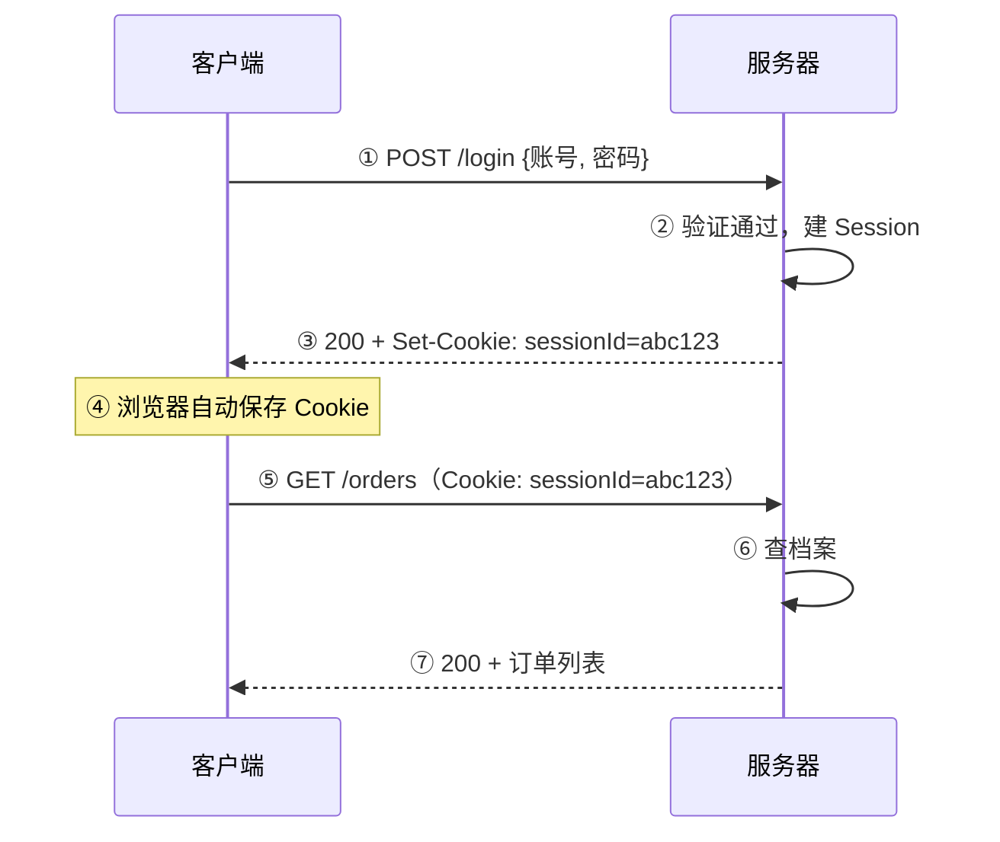
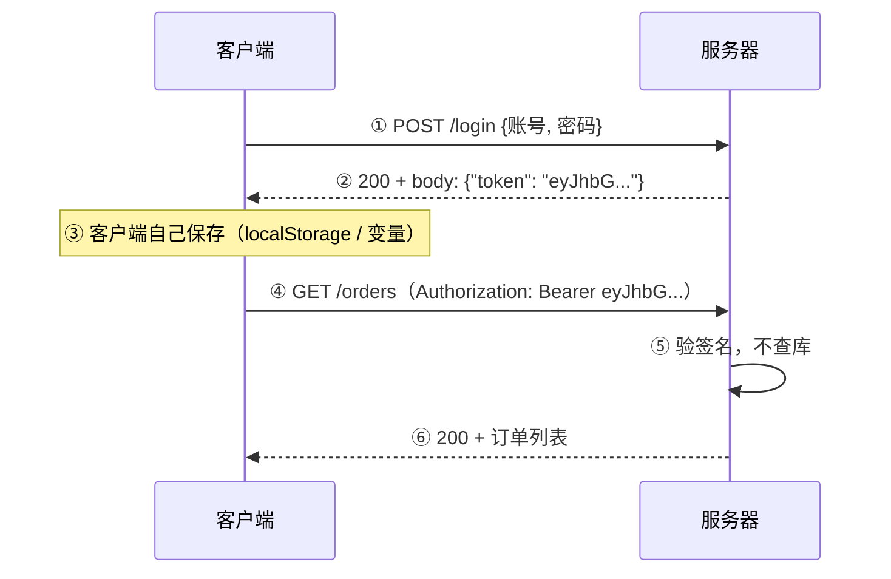
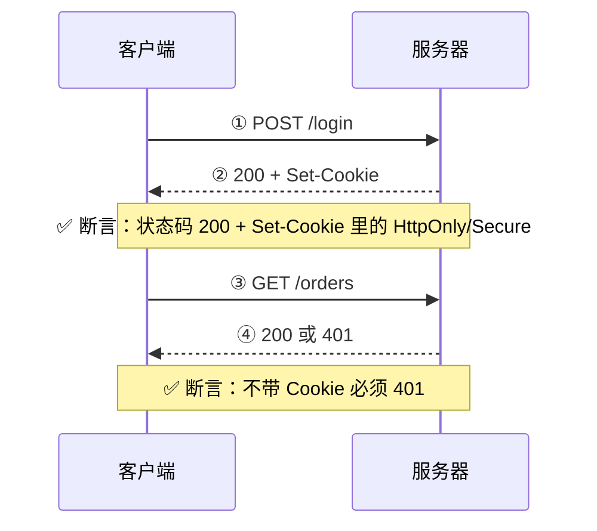

# Day 16 ｜ HTTP 进阶与鉴权

## 一、Cookie

### 1.1 一次登录的完整往返（自己画一遍）

**Cookie 方案**



**Token 方案**



| 维度 | Cookie 方案 | Token 方案 |
| --- | --- | --- |
| 凭证在哪 | 响应头 Set-Cookie | 响应体 body.token |
| 谁存 | 浏览器自动 | 客户端自己 |
| 谁带 | 浏览器自动 | 客户端手动加 Authorization |
| 服务端验证 | 查 session 存储 | 只验签名 |

**测试在哪断言**



### 1.2 Cookie 五个属性表

| 属性 | 作用 | 不设它会怎样 | 测试点 |
| --- | --- | --- | --- |
| Expires / Max-Age | 有效期 | 关浏览器就没了（会话 Cookie） | 过期后是否要求重新登录 |
| Domain | 对哪些域名生效 | 只对当前域名 | 设太宽 → 子域都能读 → 泄露 |
| Path | 对哪些路径生效 | 当前路径及子路径 | 设太窄 → 该带的请求没带 |
| HttpOnly | JS 读不到 | document.cookie 能读到 → XSS 偷走 | 登录 Cookie 有没有它 |
| Secure | 只在 HTTPS 发 | HTTP 请求也发 → 被中间人截获 | HTTP 环境下是否泄露 |
| SameSite | 跨站请求是否带 | 新版浏览器默认 Lax | CSRF 防御是否生效 |

- HttpOnly + Secure = 登录 Cookie 的最低配置。缺一个就是安全问题。
- 为什么 Cookie 要加 HttpOnly → 防 XSS 通过 document.cookie 偷会话。

### 1.3 我的实验输出（set-cookie 头 / cookies.txt 内容）

#### 看服务器发了什么

**输入**

```bash
curl -s -o /dev/null -D - https://www.baidu.com | grep -i "^set-cookie:"
```

**输出**

```
Set-Cookie: BDORZ=27315; max-age=86400; domain=.baidu.com; path=/
```

- `-I` 让curl发的是 HEAD 请求，百度对它不下发 Cookie
- 不加 `-I` 时 curl 默认发 **GET**；`-D -` 只是把响应头打印出来，它不决定方法
- HEAD 在规范上本来是为了“只看头、不要体”，理论上应与 GET 一致；但实际实现中很多服务器（尤其 CDN、WAF）对 HEAD 走的是另一条代码路径，会跳过“下发 Cookie”这种有副作用的逻辑。
- HEAD 的响应头，不等于 GET 的响应头

#### 把 Cookie 存到文件（-c = cookie jar，写入）

**输入**

```bash
curl -s -c cookies.txt -o /dev/null https://www.baidu.com
cat cookies.txt
```

**输出**

```
# Netscape HTTP Cookie File
# https://curl.se/docs/http-cookies.html
# This file was generated by libcurl! Edit at your own risk.

.baidu.com      TRUE    /       FALSE   1794104625      BDORZ   27315
```

- 观察：这条 Set-Cookie 既没有 `HttpOnly` 也没有 `Secure`，
  对应 cookies.txt 里行首是 `.baidu.com` 而不是 `#HttpOnly_.baidu.com`
- BDORZ 是防刷 Cookie，不敏感，不算缺陷；但**形状**就是“最低配置缺失”的样子

#### 带着这个 Cookie 再请求（-b = 带上 Cookie）

**输入**

```bash
curl -s -b cookies.txt -o /dev/null -w "%{http_code}\n" https://www.baidu.com
```

**输出**

```
200
```

- 说明百度首页不校验 Cookie（和昨天"不校验方法"一个道理）。真实鉴权要测的是需要登录的接口，不是首页。

#### -c和-b的区别

| 参数 | 方向 | 记法 |
| --- | --- | --- |
| -c | 写入文件 | c = cookie jar（罐子，存进去） |
| -b | 读文件并发送 | b = browser（像浏览器一样带出去） |

## 二、Session

### 2.1 Cookie vs Session：一句话区别

- Cookie 是"信封"，Session 是"档案"。
- 更准确：**Cookie 里通常只装"索引"（sessionId），真正的"内容"（用户数据）在服务端**。
  客户端每次只递索引，服务端拿索引去查内容。

```
登录成功 → 服务器建一份档案（Session #abc123）
         → 把档案号（abc123）塞进信封（Cookie）寄给你
下次请求 → 你寄回信封
         → 服务器拆开看到 abc123
         → 去档案柜查 #abc123 → 查到「张三，管理员」
```

### 2.2 集群为什么会掉线（画图）

- 问题：单机没问题。一旦部署两台

```
        ┌─ 服务器 A（内存里存着 session #abc123 → 张三）
请求 1 ─┤
        └─ 服务器 B（内存里没有 #abc123）

请求 2（带 Cookie: abc123）→ 负载均衡打到 B → 查不到 → 401「请重新登录」
```

- 表现：用户"登录了但一直掉线"，刷新几次又好 —— 典型症状：时好时坏，取决于打到哪台机器。

### 2.3 三种解法对比

| 方案 | 做法 | 优点 | 缺点 |
| --- | --- | --- | --- |
| 粘性会话（sticky） | 负载均衡按 Cookie 把同一用户固定到同一台 | 改造成本最低 | 那台挂了用户就掉线；扩缩容会打乱 |
| Session 共享 | 所有机器读写同一个 Redis | 简单可靠 | 多一次网络 IO；Redis 挂了全站登录失效 |
| 无状态化（Token/JWT） | 服务端不存，凭证自带信息 + 签名 | 扩容无成本 | 无法立即撤销（见 3.4） |

### 2.4 测试点

| # | 测试点 | 怎么造 | 期望 |
| --- | --- | --- | --- |
| 1 | 不登录直接访问受保护接口 | 不带 Cookie | 401 |
| 2 | 伪造 sessionId | 改成随便一个值 | 401，且不能泄露"该 id 不存在" |
| 3 | 集群一致性 | 连续请求 20 次（走不同机器） | 全部 200，不能时好时坏 |
| 4 | 会话过期 | 等超时 / 手动删 Redis | 401，提示"请重新登录" |
| 5 | 注销后 | 调 logout 再访问 | 401（最容易出 Bug） |
| 6 | 并发登录 | 同一账号两个浏览器 | 看产品定义（挤掉前一个还是都允许） |

## 三、Token 与 JWT

### 3.1 JWT 三段分别是什么

```
eyJhbGciOiJIUzI1NiIsInR5cCI6IkpXVCJ9  .  eyJzdWIiOiIxMjM0NTY3ODkwIiwibmFtZSI6IkpvaG4gRG9lIiwiaWF0IjoxNTE2MjM5MDIyfQ  .  SflKxwRJSMeKKF2QT4fwpMeJf36POk6yJV_adQssw5c
└──────────── header ────────────┘    └──────────────── payload ──────────────────┘    └─────────── signature ───────────┘
```

| 段 | 内容 | 作用 |
| --- | --- | --- |
| header | {"alg":"HS256","typ":"JWT"} | 用什么算法签名 |
| payload | {"sub":"1234567890","name":"John Doe","iat":1516239022} | 用户信息 + 签发时间 |
| signature | 一串哈希 | 防篡改 |

- 三段用 . 连接，每段都是 base64url 编码。

### 3.2 我解码出来的 header / payload（贴真实输出）

**输入**

```bash
jwt="eyJhbGciOiJIUzI1NiIsInR5cCI6IkpXVCJ9...."
python -c "import base64,sys;s=sys.argv[1];s+='='*(-len(s)%4);print(base64.urlsafe_b64decode(s).decode())" "$(echo $jwt | cut -d. -f1)"
```

**输出**

```
{"alg":"HS256","typ":"JWT"}
{"sub":"1234567890","name":"John Doe","iat":1516239022}
```

### 3.3 payload 是明文 —— 能放什么、不能放什么

- 能放：用户 id、角色、过期时间
- 不能放：密码、手机号、身份证号、密钥
- 测试点：拿到 token，解码 payload，检查里面有没有敏感信息。有 → 提安全 Bug。
- JWT 安全吗 → 答：payload 明文可读，安全性靠"不能篡改"（签名）保证，不靠"看不见"。

### 3.4 无状态的三个代价 + refresh token 方案

- 好处：任何服务器都能验证，不用共享 session，扩容没成本。

- 代价：

| 代价 | 说明 |
| --- | --- |
| 无法立即撤销 | 用户点"退出登录"，token 在过期前依然有效 |
| 无法改权限 | 管理员被降权，旧 token 里还是 admin，直到过期 |
| token 越大越慢 | 塞太多信息，每个请求都多传几百字节 |

- 真实系统常用"短有效期 + refresh token"：

```
access_token   15 分钟过期   ← 泄露了也只有 15 分钟窗口
refresh_token  7 天过期      ← 存在服务端（可撤销），用来换新的 access_token
```

| 代价 | 后果一句话 | refresh token 能治吗 |
| --- | --- | --- |
| ① 无法撤销 | 离职/泄露后还有一段“免死窗口” | ⚠️ 压缩到 ≤15 分钟，不是立即 |
| ② 无法改权限 | 降权/封号后旧凭证仍生效 | ⚠️ 同样压缩窗口，关键接口要额外查库 |
| ③ token 太大 | 变慢、被网关拒、日志量增长 | ❌ 无效，反而更糟 |

- refresh token 的作用不是“让 JWT 能撤销”，而是“把撤销的延迟从几天缩短到几分钟”。 它用每用户一条记录的有状态，换来了可接受的窗口 —— 这是折中，不是解决。
- 无状态的代价不是“凭证会泄露” —— 任何方案都会；而是“泄露之后没有紧急失效手段”。 解决办法只有两个：缩短有效期（把窗口压到 15 分钟），或加黑名单（回到有状态）。

## 四、鉴权对照表（今天的主产出）

### 4.1 三方案横向对比（10 个维度）

| 维度 | Cookie + Session | Token（普通） | JWT |
| --- | --- | --- | --- |
| 状态存在哪 | 服务端（内存/Redis） | 服务端（token 表） | 服务端不存 |
| 客户端存什么 | sessionId（号码） | 一串随机字符 | 三段式字符串 |
| 怎么传 | Cookie: 头（自动） | Authorization: Bearer | Authorization: Bearer |
| 服务端每次要查库吗 | 要 | 要（查 token 表） | 不要（只验签） |
| 能立即撤销吗 | ✅ 删 session 即可 | ✅ 删记录 | ❌ 不能 |
| 集群要共享吗 | ✅ 要 | ✅ 要 | ❌ 不用 |
| 跨域（前端独立部署） | ❌ 麻烦（要配 CORS + credentials） | ✅ 容易 | ✅ 容易 |
| 移动端 | ❌ 不友好 | ✅ 友好 | ✅ 友好 |
| CSRF 风险 | ⚠️ 有（浏览器自动带） | ✅ 低 | ✅ 低 |
| XSS 风险 | 低（HttpOnly 防住） | ⚠️ 高（存 localStorage 会被偷） | ⚠️ 高（同上） |

- XSS 的目标是「让你的浏览器执行我的代码」，CSRF 的目标是「让你的浏览器替我做请求」。 前者靠「输入不可信」防御，后者靠「凭证不跨站」防御。
- Cookie 方案怕 CSRF，Token 方案怕 XSS。 Cookie 是浏览器自动带的（攻击者能借你的手发请求）；Token 要 JS 手动加（XSS 一偷就完）。
- JWT 的"无状态"是优点也是缺点 —— 同一个特性，带来扩容方便，也带来无法撤销。

### 4.2 测试点对照表（10 个测试点）

| 测试点 | Cookie+Session | Token | JWT |
| --- | --- | --- | --- |
| 不带凭证访问 | 401 | 401 | 401 |
| 凭证乱填 | 401 | 401 | 401 |
| 凭证过期 | 401 | 401 | 401 |
| 凭证被篡改 | 401（id 对不上） | 401（查不到） | 401（验签失败） |
| 注销后立即失效 | ✅ 应生效 | ✅ 应生效 | ❌ 通常不生效 |
| 并发 / 多端 | 看产品 | 看产品 | 看产品 |
| 敏感信息泄露 | Cookie 里不能有用户数据 | token 不能明文可读 | payload 必须解码检查 |
| 跨域配置 | CORS + credentials | CORS | CORS |
| CSRF 防护 | 检查 SameSite / CSRF token | 不适用 | 不适用 |
| XSS 防护 | 检查 HttpOnly | 检查存储位置 | 检查存储位置 |

### 4.3 决策表（什么场景选什么）

| 场景 | 推荐 | 理由 |
| --- | --- | --- |
| 传统服务端渲染网站 | Cookie + Session | 简单，浏览器自动带 |
| 前后端分离 / SPA | Token 或 JWT | 跨域友好 |
| 移动端 App | Token / JWT | 没有 Cookie 机制 |
| 微服务 / 多服务互信 | JWT | 各服务独立验签，不用共享 session |
| 需要"立即踢下线" | Session 或 Token（带表） | JWT 做不到 |
| 第三方授权（微信登录） | OAuth2 | 标准协议（OAuth2 是独立的授权框架） |

## 五、RESTful

### 5.1 资源 vs 动作

- 路径里只出现"名词"（资源），"动词"（动作）由 HTTP 方法表达。例如：

**不 REST**：

```text
GET  /getUser?id=1
POST /deleteUser?id=1
POST /updateUser
```

**REST**：

```text
GET    /users/1
DELETE /users/1
PATCH  /users/1
```

### 5.2 五个方法对应表

| 动作 | 方法 | 路径 | 成功状态码 |
| --- | --- | --- | --- |
| 查列表 | GET | /users | 200 |
| 查单个 | GET | /users/1 | 200 / 404 |
| 新建 | POST | /users | 201 + Location |
| 全量改 | PUT | /users/1 | 200 / 204 |
| 部分改 | PATCH | /users/1 | 200 / 204 |
| 删除 | DELETE | /users/1 | 204（无体） |

### 5.3 设计审查清单 6 条

| # | 审查项 | 不合格的样子 |
| --- | --- | --- |
| 1 | 路径里有没有动词 | /getUser、/deleteOrder |
| 2 | 方法用得对不对 | 用 POST 做查询、用 GET 做删除 |
| 3 | 状态码是否和语义一致 | 全 200，错误码塞在 body 里 |
| 4 | 资源层级是否合理 | /users/1/orders/2/items/3 太深，或 /getUserOrders |
| 5 | 是否有版本号 | /api/v1/users（没有版本，改接口就炸客户端） |
| 6 | 幂等是否匹配 | PUT 重复调用结果一样吗？POST 有没有防重？ |

## 六、自检 10 题

| # | 问题 | 一句话回答 |
| --- | --- | --- |
| 1 | Cookie 和 Session 的区别（一句话） | cookie里面是索引，session里面是内容 |
| 2 | HttpOnly 和 Secure 各防什么 | HttpOnly 防 XSS 偷 Cookie；Secure 防明文传输被截获 |
| 3 | 集群下 Session 为什么会掉线，三种解法 | 粘性会话、无状态、Session 共享 |
| 4 | JWT 三段分别是什么、各自作用 | header：用什么算法；payload：用户信息；signature：防篡改 |
| 5 | payload 能直接读吗？为什么这不算泄露 | 因为 payload 是 base64url 编码，不是加密，所以payload里面不应该有敏感信息 |
| 6 | 签名防的是什么 | 防篡改 |
| 7 | JWT 为什么"无法立即撤销"，工程上怎么解决 | token存在调用端，服务端没办法直接撤销。一般使用短有效期 + refresh token |
| 8 | Cookie 方案怕 CSRF、Token 方案怕 XSS，为什么 | Cookie是浏览器自带的所以怕CSRF，token要手动加入，容易被XSS获取 |
| 9 | RESTful 路径里该有什么、不该有什么 | 路径里该有“资源”，不该有“动作” |
| 10 | 拿到接口文档，你审哪 6 条 | 见5.3 |

## 七、还没搞懂的

- 无

## 八、需要背下来的

1. HttpOnly 和 Secure 各防什么：HttpOnly 防 XSS 偷 Cookie；Secure 防明文传输被截获
2. RESTful 路径里该有什么、不该有什么：路径里该有“资源”，不该有“动作”
3. 拿到接口文档审哪 6 条：见 5.3
